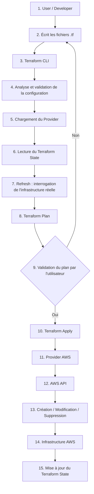
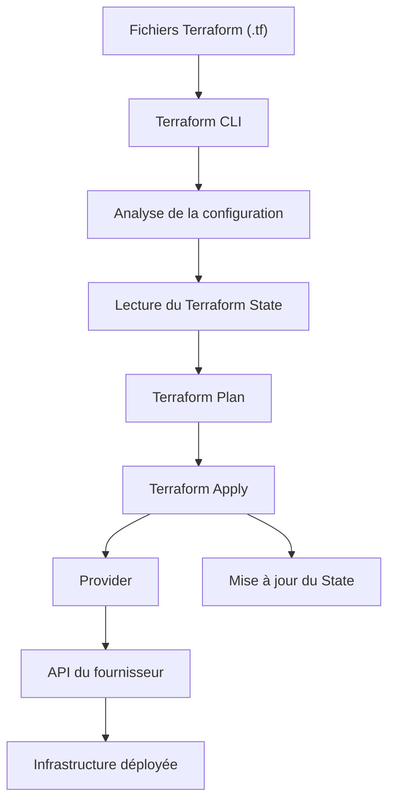
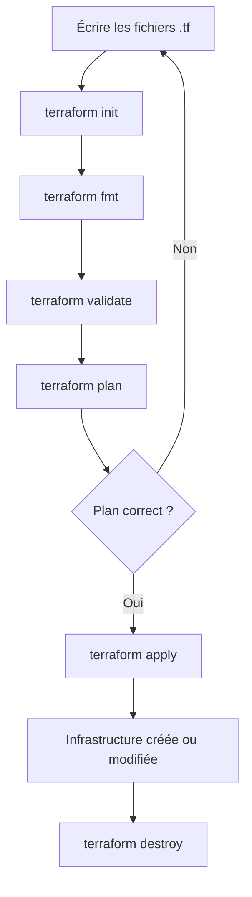

# 01 — Introduction à l'Infrastructure as Code & Premier déploiement avec Terraform

> **Objectif :** comprendre les principes de l'Infrastructure as Code, découvrir Terraform et préparer l'environnement de travail pour réaliser un premier déploiement AWS.

> **Idée clé :** avec Terraform, on décrit l'état souhaité d'une infrastructure dans des fichiers de configuration. Terraform compare cette configuration avec son état connu et communique avec les providers pour créer, modifier ou supprimer les ressources nécessaires.

---

## 1. Pourquoi l'Infrastructure as Code ?

### 1.1. Gestion traditionnelle d'une infrastructure

Dans une approche traditionnelle, un administrateur configure généralement l'infrastructure à travers des interfaces graphiques ou des commandes exécutées manuellement.

Par exemple, pour déployer un serveur Web, il peut devoir :

1. Se connecter à la console du fournisseur Cloud.
2. Créer une instance virtuelle.
3. Choisir une image système et une taille d'instance.
4. Configurer le réseau et les règles de sécurité.
5. Démarrer l'instance.
6. Installer et configurer le serveur Web.

Cette méthode fonctionne, mais elle présente plusieurs limites :

- Les opérations manuelles sont répétitives.
- Une erreur de configuration peut être difficile à détecter.
- Il est difficile de reproduire exactement le même environnement.
- La documentation peut ne pas refléter l'infrastructure réellement déployée.
- Les modifications sont difficiles à suivre et à auditer.

### 1.2. Définition de l'Infrastructure as Code

L'**Infrastructure as Code (IaC)** est une approche qui consiste à définir et gérer les composants d'une infrastructure à l'aide de fichiers de configuration ou de code.

Au lieu de créer manuellement les ressources, l'administrateur décrit l'état souhaité de l'infrastructure. Un outil IaC interprète cette description et réalise les opérations nécessaires.

Exemples de ressources pouvant être gérées avec l'IaC :

- Machines virtuelles.
- Réseaux et sous-réseaux.
- Règles de sécurité.
- Load balancers.
- Bases de données.
- Buckets de stockage.
- Utilisateurs et permissions...

### 1.3. Approche manuelle vs Infrastructure as Code

| Approche manuelle | Infrastructure as Code |
|---|---|
| Création via une console ou des commandes ponctuelles | Description dans des fichiers de configuration |
| Opérations souvent répétitives | Opérations automatisables |
| Reproduction parfois difficile | Configuration réutilisable |
| Modifications difficiles à tracer | Historique possible avec Git |
| Risque d'incohérences entre environnements | Possibilité de standardiser les environnements |

### 1.4. Les principaux avantages de l'IaC

- **Automatisation :** réduire les opérations manuelles.
- **Répétabilité :** reproduire une infrastructure à partir d'une configuration.
- **Versionnement :** suivre les changements avec Git.
- **Cohérence :** appliquer une configuration commune à plusieurs environnements.
- **Traçabilité :** examiner les modifications proposées avant leur application.
- **Collaboration :** partager et revoir les configurations entre membres d'une équipe.

### 1.5. Les approches déclarative et impérative

#### Approche impérative

L'utilisateur décrit les actions à exécuter et *leur ordre*.

Exemple conceptuel :

```text
1. Créer un réseau.
2. Créer une machine virtuelle.
3. Attacher la machine au réseau.
4. Ajouter une règle de sécurité.
```

#### Approche déclarative

L'utilisateur décrit le résultat souhaité. L'outil détermine les opérations nécessaires pour atteindre cet état.

Exemple conceptuel :

```text
Je souhaite :
- un réseau ;
- une machine virtuelle connectée à ce réseau ;
- une règle autorisant le trafic HTTP.
```

Terraform utilise principalement une approche **déclarative**.

---

## 2. Présentation de Terraform

### 2.1. Qu'est-ce que Terraform ?

[Terraform Documentation](https://developer.hashicorp.com/terraform/docs)  

**Terraform** est un outil d'Infrastructure as Code développé par HashiCorp. Il permet de définir, provisionner et gérer des ressources d'infrastructure à l'aide de fichiers de configuration.

Terraform peut communiquer avec différents fournisseurs et plateformes grâce aux **providers**.    
[Terraform providers Documentation](https://registry.terraform.io/browse/providers)
Exemples :  

- [AWS](https://registry.terraform.io/providers/hashicorp/aws/latest)
- Microsoft Azure.
- Google Cloud Platform.
- VMware vSphere.
- [Docker](https://registry.terraform.io/providers/docker/docker/latest/docs)
- Kubernetes...

### 2.2. Le fonctionnement général de Terraform

L'utilisateur décrit l'infrastructure dans des fichiers `.tf`. Terraform lit ces fichiers, consulte son état et communique avec les APIs des providers pour déterminer et réaliser les changements nécessaires.




### 2.3. Les composants essentiels

#### Terraform CLI

C'est l'outil en ligne de commande utilisé pour initialiser un projet, vérifier la configuration, préparer un plan et appliquer les modifications.

#### Provider

Un provider est un plugin qui permet à Terraform d'interagir avec une plateforme ou un service.

Exemple : le provider AWS permet de gérer des ressources AWS.

#### Resource

Une resource représente un composant que Terraform peut créer, modifier ou supprimer.

Exemples :

- `aws_instance`
- `aws_security_group`
- `aws_s3_bucket`

#### Data Source

Une data source permet de lire des informations sur une ressource ou un objet existant sans nécessairement le créer.

#### Terraform State

Le State est un fichier de données utilisé par Terraform pour enregistrer les ressources qu'il gère et établir une correspondance entre la configuration et les objets réels.

#### Configuration HCL

Terraform utilise **HashiCorp Configuration Language (HCL)** pour décrire l'infrastructure.

Exemple :

```hcl
resource "aws_instance" "web" {
  ami           = "ami-xxxxxxxx"
  instance_type = "t3.micro"
}
```

Cet extrait déclare une ressource EC2 gérée par le provider AWS.


### 2.4 Le workflow Terraform

Le workflow de base comprend plusieurs commandes.

#### 2.4.1 `terraform init`

Initialise le répertoire de travail Terraform.

Cette commande télécharge notamment les providers nécessaires et prépare le répertoire `.terraform`.

```bash
terraform init
```

#### 2.4.2 `terraform fmt`

Formate les fichiers Terraform selon les conventions de Terraform.

```bash
terraform fmt
```


#### 2.4.3 `terraform validate`

Vérifie la cohérence syntaxique et structurelle de la configuration.

```bash
terraform validate
```

Cette commande ne garantit pas que les ressources pourront réellement être créées chez le fournisseur Cloud.

#### 2.4.4 `terraform plan`

Présente les changements que Terraform prévoit d'effectuer.

```bash
terraform plan
```

Terraform compare la configuration avec les informations disponibles dans le State et l'infrastructure distante.

#### 2.4.5 `terraform apply`

Applique les changements nécessaires pour atteindre l'état souhaité.

```bash
terraform apply
```

Terraform affiche un plan et demande une confirmation avant d'appliquer les modifications, sauf utilisation d'options qui modifient ce comportement.

#### 2.4.6 `terraform destroy`

Supprime les ressources gérées par la configuration et le State concernés.

```bash
terraform destroy
```

Cette commande peut entraîner une suppression réelle de ressources Cloud. Vérifiez toujours le plan et l'environnement ciblé avant de confirmer.

#### 2.4.7 Vue d'ensemble du workflow



### Résumé des commandes

| Commande | Rôle |
|---|---|
| `terraform init` | Initialiser le projet |
| `terraform fmt` | Formater la configuration |
| `terraform validate` | Vérifier la configuration |
| `terraform plan` | Prévisualiser les changements |
| `terraform apply` | Appliquer les changements |
| `terraform destroy` | Détruire les ressources gérées |

---

## 3. Installation et préparation de l'environnement


### 3.1. Installation de Terraform sur Windows

Consulter la documentation officielle pour choisir la méthode d'installation adaptée à la distribution :

[Install Terraform](https://developer.hashicorp.com/terraform/install#windows)

Après installation, vérifier la version :

```bash
./terraform.exe --version
```

Ensuite, ajoute le dossier suivant à la variable Windows Path :
Appuie sur Windows + R >> Tape sysdm.cpl >> Advaced >> variable d'environnement >> var env user >> Path >> modifier >> nouvelle variable
exemple:

```bash
C:\Users\Admin\Downloads\terraform_1.17.1_windows_amd64
```

### 3.2. Préparation de Visual Studio Code

Installer Visual Studio Code :

[Visual Studio Code](https://code.visualstudio.com/)

Installer l'extension **HashiCorp Terraform** pour bénéficier notamment de :

- La coloration syntaxique HCL.
- L'auto-complétion.
- La mise en forme.
- La détection de certaines erreurs de syntaxe.

### 3.3. Configuration des credentials AWS

Terraform doit pouvoir s'authentifier auprès d'AWS pour créer et gérer des ressources.

La méthode utilisée dans ce TP est la configuration d'un profil AWS avec AWS CLI.

Installer AWS CLI si nécessaire :

[AWS CLI — Installation](https://docs.aws.amazon.com/cli/latest/userguide/getting-started-install.html)

Configurer un profil :

```bash
aws configure --profile terraform-lab
```
Vérifier le profil :  
Exécute : 

```bash
aws configure list --profile learnerlab
```

AWS CLI demande notamment (learner lab details >> show) :

```text
AWS Access Key ID
AWS Secret Access Key
Default region name
Default output format
```

Exemple de région :

```text
eu-west-1
```

Vérifier l'identité associée au profil :

```bash
aws sts get-caller-identity --profile terraform-lab
```
### 3.4. Configuration du provider 
Revisiter : [aws provider doc](https://registry.terraform.io/providers/hashicorp/aws/latest)
Nommez un fichier `provider.tf`.  
Puis ajoutez ce code en utilisant le doc:

```bash
terraform {
  required_providers {
    aws = {
      source  = "hashicorp/aws"
      version = "6.72.0"
    }
  }
}

provider "aws" {
  # Configuration options
  region  = "us-east-1"
  profile = "terraform-lab"
}
```
Puis dans le répertoire du fichier provider.tf.  
Tapez:  

```bash
terraform init 
```
si vous avez l'erreur de Path tapez  

```bash
$env:Path += ";C:\Users\Admin\Downloads\terraform_1.17.1_windows_amd64"
```
---

## 5. Premier déploiement AWS avec Terraform

---

## 6. Ce qu'il faut absolument retenir

#### Infrastructure as Code

> L'IaC consiste à décrire et gérer une infrastructure à l'aide de fichiers de configuration ou de code.

#### Terraform

> Terraform est un outil IaC qui permet de provisionner et de gérer des ressources à travers différents providers.

#### Provider

> Un provider est un plugin qui permet à Terraform de communiquer avec une plateforme ou un service.

#### Resource

> Une resource représente un composant d'infrastructure que Terraform peut gérer.


#### Terraform Workflow

> `init` prépare le projet, `plan` prévisualise les changements, `apply` les applique et `destroy` supprime les ressources gérées.

#### Terraform State

> Le State permet à Terraform de suivre les ressources et de faire le lien entre la configuration et l'infrastructure réelle.

#### HCL

> HCL est le langage de configuration utilisé pour décrire les ressources et les paramètres Terraform.

---

## Questions de compréhension

#### Question 1

Qu'est-ce que l'Infrastructure as Code ? Citer trois avantages par rapport à une configuration manuelle.

#### Question 2

Quelle est la différence entre une approche impérative et une approche déclarative ?

#### Question 3

Quel est le rôle de Terraform ?

#### Question 4

Qu'est-ce qu'un provider Terraform ? Donner deux exemples.

#### Question 5

Quelle est la différence entre une resource et une data source ?

#### Question 6

Quel est le rôle de la commande `terraform init` ?

#### Question 7

Quelle est la différence entre `terraform plan` et `terraform apply` ?

#### Question 8

La commande `terraform validate` garantit-elle que les ressources pourront être créées sur AWS ? Justifier.

#### Question 9

Quel est le rôle du fichier `terraform.tfstate` ?

#### Question 10

Pourquoi ne faut-il pas publier le fichier State dans un repository GitHub public ?

#### Question 11

Dans le bloc suivant, identifier le type de ressource, son nom logique et le provider utilisé :

```hcl
resource "aws_instance" "web" {
  instance_type = "t3.micro"
  ami           = "ami-xxxxxxxx"
}
```

### Question 12

Pourquoi est-il important d'exécuter `terraform plan` avant `terraform apply` ?
